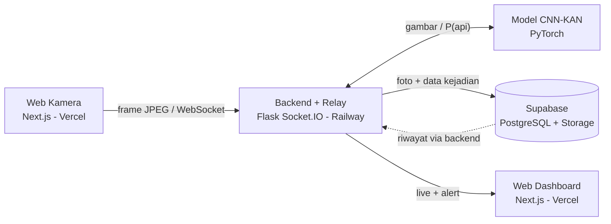

# ForestGuard

## Project Name & Description
**ForestGuard** adalah platform web berbasis AI untuk deteksi dini kebakaran hutan dan lahan. Ponsel atau laptop menjadi kamera pemantau lewat browser, model Computer Vision CNN-KAN memeriksa gambar di server, dan dashboard menampilkan live kamera (maksimal 2), peringatan, serta riwayat foto deteksi yang tersimpan di database.

Dibuat untuk **AIWIC 2026** oleh `your answer`.

## Problem & Target User
**Masalah.** Kebakaran hutan dan lahan (karhutla) di Kalimantan sering diperparah cuaca kering dan aktivitas manusia. Api menyebar cepat, terutama di lahan gambut yang bisa terbakar di bawah permukaan, sehingga sulit dideteksi dan dipadamkan. Dampaknya: kabut asap (PM2.5) yang mengganggu kesehatan, kerusakan habitat satwa, pelepasan karbon, dan terganggunya aktivitas ekonomi dan pendidikan. Api yang terlambat terdeteksi membuat risiko dan biaya penanganan meningkat, sedangkan mengawasi layar kamera sepanjang waktu tidak realistis bagi manusia.

**Pengguna yang dituju**
| Pengguna | Kebutuhan |
|---|---|
| Petugas pemantau, pemadam kebakaran, pengelola kawasan hutan | Peringatan dini otomatis, bukti visual kejadian, status kamera yang jelas |
| Petugas lapangan | Memasang kamera dengan murah dan cepat tanpa perangkat khusus |
| Relawan dan masyarakat sekitar hutan | Informasi dini untuk bersiap dan mengurangi paparan asap |

## Key Features
Fitur yang sudah berfungsi:
- Kamera live via browser (pilih kamera depan/belakang, beri nama kamera), tanpa instalasi aplikasi
- Deteksi api otomatis dengan model CNN-KAN; probabilitas tampil real-time
- Filter alarm palsu: ambang probabilitas dan syarat 2 frame berturut-turut (dapat diatur)
- Foto bukti otomatis tersimpan ke Supabase beserta waktu, nama kamera, dan tingkat keyakinan (jeda 10 detik per kamera)
- Dashboard: live maksimal 2 kamera dengan indikator status **KAMERA OFF**, **TERHUBUNG · LIVE**, **MENUNGGU VIDEO**, dan **API TERDETEKSI**
- Peringatan real-time dan riwayat deteksi dari database
- Kunci akses opsional (`ACCESS_KEY`) untuk kamera dan dashboard

## Tech Stack
| Lapisan | Teknologi |
|---|---|
| Frontend | Next.js 14 (React 18, App Router), Socket.IO client |
| Backend | Python, Flask, Flask-SocketIO (WebSocket), Flask-CORS, Gunicorn |
| Database & storage | Supabase (PostgreSQL + Storage) |
| AI | CNN-KAN (PyTorch, torchvision) |
| Hosting | Vercel (frontend), Railway (backend + model), Supabase (data) |

## AI Implementation
- **Model:** CNN-KAN (Convolutional Neural Network + Kolmogorov-Arnold Network) buatan tim, klasifikasi biner *Fire* / *Nofire*. Tidak memakai API AI eksternal. Bobot: `backend-railway/model.pth`.
- **Arsitektur:** 4 blok konvolusi (64, 128, 256, 512 filter), global average pooling, 2 lapisan KAN (B-spline orde 3; 516 dan 256 unit), lapisan klasifikasi + softmax.
- **Input:** frame JPEG dari kamera (lebar 640 px, sekitar 5 frame/detik dikirim, diperiksa tiap sekitar 0,7 detik), di-resize 224x224 dan dinormalisasi (ImageNet).
- **Output:** probabilitas kelas *Fire* (0-1). Api dinyatakan terdeteksi jika melewati `FIRE_THRESHOLD` (default 0,5) pada `CONSEC_FRAMES` (default 2) frame berturut-turut, lalu foto disimpan dan peringatan dikirim ke dashboard.
- **Fungsi:** menggantikan pengawasan layar manual dengan pemeriksaan otomatis yang konsisten.
- Dataset, hasil evaluasi, dan detail lain: lihat [DISCLOSURE.md](DISCLOSURE.md).

## Architecture / Data Flow

1. Web kamera mengirim frame ke backend lewat WebSocket.
2. Backend meneruskan frame ke dashboard (live) dan meminta model memeriksa frame secara berkala.
3. Jika api terdeteksi, backend menyimpan foto ke Supabase Storage dan data ke tabel `detections`, lalu mengirim peringatan ke dashboard.
4. Dashboard memuat riwayat dari database melalui backend.

Struktur repository:
| Folder | Isi |
|---|---|
| `backend-railway/` | Backend Flask + model, relay live, simpan ke Supabase (Dockerfile untuk Railway) |
| `camera-web/` | Next.js: halaman kamera (Vercel) |
| `dashboard-web/` | Next.js: dashboard live + riwayat (Vercel) |
| `supabase/schema.sql` | Tabel `detections` dan bucket foto |
| `docs/` | Screenshot dan dokumentasi |

## Run Instructions
Prasyarat: Python 3.10+, Node.js 18+, akun Supabase (opsional untuk tes tanpa penyimpanan foto).

```bash
# 1. Supabase: jalankan supabase/schema.sql di SQL Editor, catat Project URL dan service_role key

# 2. Backend
cd backend-railway
pip install torch torchvision && pip install -r requirements.txt
# set variabel sesuai .env.example (SUPABASE_URL, SUPABASE_SERVICE_KEY, ...)
python app.py                  # http://localhost:5000/health

# 3. Dashboard
cd dashboard-web && cp .env.example .env.local     # NEXT_PUBLIC_API_URL=http://localhost:5000
npm install && npm run dev                          # http://localhost:3000

# 4. Kamera
cd camera-web && cp .env.example .env.local
npm install && npm run dev -- -p 3001               # http://localhost:3001
```
Cara memakai: buka dashboard, lalu buka halaman kamera dan klik **Buka Kamera**. Kamera di HP butuh HTTPS, jadi uji lewat URL Vercel.

**Environment variables** (jangan commit nilai asli; lihat `.env.example` di tiap folder)
| Lokasi | Variable | Keterangan |
|---|---|---|
| backend | `SUPABASE_URL`, `SUPABASE_SERVICE_KEY` | Dari Supabase > Project Settings > API |
| backend | `ALLOWED_ORIGINS` | URL Vercel dipisah koma; `*` hanya untuk tes |
| backend | `ACCESS_KEY`, `FIRE_THRESHOLD`, `CONSEC_FRAMES`, `COOLDOWN_SECONDS`, `INFER_INTERVAL_MS` | Opsional |
| camera-web, dashboard-web | `NEXT_PUBLIC_API_URL` | URL backend Railway |

**Deploy:** Railway (*Root Directory* `backend-railway`, 1 replica, Generate Domain) lalu Vercel dua project (*Root Directory* `camera-web` dan `dashboard-web`, isi `NEXT_PUBLIC_API_URL`), terakhir isi `ALLOWED_ORIGINS` di Railway dengan dua URL Vercel.

## Deployment URL
| Item | Tautan |
|---|---|
| Web Dashboard | `https://dashboard-web-omega-lilac.vercel.app/` |
| Web Kamera | `https://camera-web-beta.vercel.app/` |
| Backend health check | `[isi URL Railway]/health` |

## Team Members
| Nama | Peran | GitHub |
|---|---|---|
| `Sheva Arzadina Hizbullah Kurniawan` | `AI/model` | `` |
| `Bagas Satrio Wicaksono ` | `Full Stack web development ` | `[isi]` |
| `Gesangrah Swandaru Pratama` | `backend/fontend` | `[isi]` |

Asal instansi: `Politeknik Negeri Malang`

## Known Limitations
- Hanya mendeteksi api, belum asap
- Alarm palsu atau api terlewat dapat terjadi pada kondisi ekstrem (kabut, malam gelap, api sangat jauh)
- Maksimal 2 kamera live; status kamera disimpan di memori sehingga backend harus 1 instance
- Inferensi di CPU; kecepatan bergantung sumber daya server
- Belum ada sensor IoT, prediksi risiko, data cuaca, ESP32-CAM/CCTV, notifikasi ponsel, dan login akun (roadmap)
- Alat bantu peringatan dini; hasil perlu diverifikasi manusia

## Third-party Resources
| Sumber | Kegunaan | Lisensi |
|---|---|---|
| PyTorch, torchvision | Menjalankan model | BSD-style |
| Flask, Flask-CORS, Flask-SocketIO, simple-websocket | Backend dan WebSocket | BSD / MIT |
| Gunicorn | Server produksi | MIT |
| Pillow, requests | Pengolahan gambar, HTTP ke Supabase | HPND, Apache-2.0 |
| Next.js, React | Frontend | MIT |
| Socket.IO client | Komunikasi real-time | MIT |
| Supabase | Database dan penyimpanan foto (layanan) | - |
| Vercel, Railway | Hosting (layanan) | - |
| Dataset | `[isi nama, sumber, lisensi]` | `[isi]` |
| Implementasi KAN | `[isi: efficient-kan (Blealtan, MIT) atau tulis "implementasi sendiri"]` | `[isi]` |
| AI coding assistant | Claude (Anthropic), membantu menyusun kode deployment dan dokumentasi | - |

Detail lengkap: [DISCLOSURE.md](DISCLOSURE.md).

## Screenshot
Simpan gambar di [`docs/screenshots`](docs/screenshots), lalu aktifkan baris berikut:
<!--


-->
